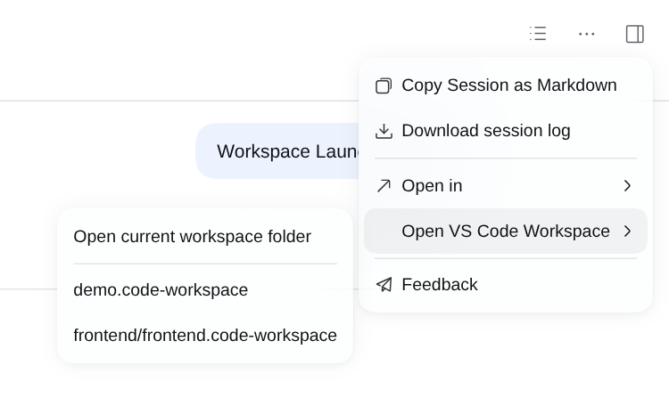

<h1 align="center">DSH VS Code Workspace Launcher</h1>

从 DeepSeek Harness 会话右上角的 **… → 打开 VS Code 工作区**，直接在 VS Code 打开当前目录或其中的 `.code-workspace` 文件，不用离开会话去找路径。

**项目状态：** [安装包与发布说明](https://github.com/Sth32/dsh-vscode-workspace-launcher/releases/latest) · [兼容与验证](#兼容与验证) · [MIT](LICENSE)

DSH Web 实机：同一个子菜单打开当前目录、根目录工作区文件和子目录工作区文件。

## 安装

- **Desktop：** 在「插件 → 添加插件」填写 `github:Sth32/dsh-vscode-workspace-launcher`，启用后按提示重启。
- **Web：** `dsh plugin --profile web add github:Sth32/dsh-vscode-workspace-launcher`。其他配置文件请替换 `web`。
- **锁定版本：** 从 [Releases](https://github.com/Sth32/dsh-vscode-workspace-launcher/releases) 选定版本，把对应的 `.tgz` 下载链接填入「添加插件」。

升级、重启与安装报错

已装旧版优先使用插件管理器的更新入口（如有），不要重复提交同一仓库地址当作升级。若提示「无法从依赖变更中确定安装了哪一个包」，改用 `github:Sth32/dsh-vscode-workspace-launcher#<完整提交 SHA>`。仍不能替换时，先记下搜索深度，再移除旧版并安装目标版本。升级后完全退出并重启 DSH（仅刷新网页不会替换宿主模块），在插件详情确认「当前版本」。

从源码打包可执行 `npm pack`，然后用 `dsh plugin --profile web add /绝对路径/插件包.tgz` 安装。

## 使用

1. 打开会话右上角 **…**，悬停或用键盘进入 **打开 VS Code 工作区**。这是独立菜单项，不修改原生「在应用中打开」。
2. 选 **打开当前工作区文件夹**，或按相对路径选择某个 `.code-workspace` 文件。
3. 在插件设置调整 **搜索深度**（0–8，默认 2）：0 只查会话工作目录，1 再查一级子目录，以此类推。

## 兼容与验证

- **允许安装：** DSH `>=0.2.2-rc.5 <0.3.0-0`（含后续 0.2.x 预览版）。允许安装不等于已验证；Node.js 需满足 DSH 宿主要求。
- **实际验证：** v0.1.4 在 Linux 的 DSH Web 0.2.2-rc.5 和 0.2.3-alpha.2 验证安装、菜单、搜索深度以及两种启动参数（使用替身编辑器）。此前 v0.1.3 在 DSH Web 0.2.2-rc.5 + VS Code 1.147.0 也验证了真实打开目录和工作区文件。

扫描范围、本机要求与开发

以当前会话的实际工作目录为准，不依赖工作区注册或分组。最多扫描 4,000 个条目、返回 100 个结果；跳过 Git、`node_modules` 和符号链接，截断时给出提示。不会读取工作区文件内容，也不会修改 DSH 工作区、权限、会话或首选编辑器。请只打开可信文件，Workspace Trust 由 VS Code 处理。

只支持本机 DSH 宿主的所有者连接，不支持 SSH 模式或远程浏览器。Linux/macOS 从可信安装目录或宿主启动时的 PATH 查找 `code`；Windows 查找常规安装目录或 PATH 上的 `Code.exe`，不通过 shell 执行 `code.cmd`。

开发者可运行 `npm test`，使用临时目录和替身编辑器，不需要模型额度。变更记录见 [Releases](https://github.com/Sth32/dsh-vscode-workspace-launcher/releases)。本插件由社区维护，与 DeepSeek 和 Microsoft 无隶属关系。

